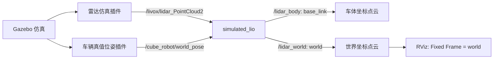

# 模拟 LIO 接线指南

本练习使用仓库已有的仿真驱动与 `simulated_lio` 节点，完成输入输出连接、launch 配置和 RViz 验证。完成后，应能说明每条线传什么消息、为什么只启动节点还收不到数据，以及如何确认系统已经接通。

## 1. 先认识本练习的模块

基础仿真与模拟 LIO 分开启动：



图中的 `simulated_lio` 需要学生单独启动并接入。默认 `sim_launch.py` 没有启动它，因此只运行 `run_sim_local.sh` 时，没有 `/lidar_body` 和 `/lidar_world` 输出属于正常状态。

“模拟 LIO”是这个教学节点的名称。当前实现使用 Gazebo 提供的车辆真值位姿，结合车模中固定的雷达安装外参，对整帧点云进行坐标变换。它没有订阅 IMU，也没有通过 LiDAR/IMU 观测估计车辆状态；同一帧统一使用一个车体位姿，未使用逐点采样时间进行去畸变。

模块发布的是 `PointCloud2`。`/lidar_world` 表示点已经表达在 `world` 坐标系中，不表示节点已经完成累计建图、回环或二维栅格地图生成。`/cube_robot/odom` 由 Gazebo 真值位姿插件发布，也不是这个节点估计出的里程计。

## 2. 第一阶段：只验证仿真驱动

先按根目录 README 安装依赖并完成编译。在仓库根目录启动基础仿真：

```bash
bash ./run_sim_local.sh
```

无图形会话时可以使用 headless：

```bash
MAP_SIM_GZCLIENT=0 bash ./run_sim_local.sh
```

等待车辆生成、控制器完成激活。下面的检查使用另一个终端；在每个新终端的仓库根目录加载环境：

```bash
source /opt/ros/humble/setup.bash
source ws/install/setup.bash
```

### 2.1 核对驱动提供的接口

| 驱动输出 | 消息类型 | 用途与坐标信息 |
|---|---|---|
| `/livox/lidar` | `livox_ros_driver2/msg/CustomMsg` | Livox 自定义格式点云；本次接线使用下面的 PointCloud2 接口 |
| `/livox/lidar_PointCloud2` | `sensor_msgs/msg/PointCloud2` | 原始点云，当前传感器名为 `livox`；现场应读取消息中的 `header.frame_id` 核对 |
| `/cube_robot/world_pose` | `geometry_msgs/msg/PoseStamped` | 车辆真值位姿，`header.frame_id` 为 `world` |
| `/cube_robot/odom` | `nav_msgs/msg/Odometry` | 真值里程计，参考系为 `world`、车体为 `base_link` |
| `/clock` | `rosgraph_msgs/msg/Clock` | 仿真时间源 |

检查消息类型、发布者和消息头：

```bash
ros2 topic type /livox/lidar_PointCloud2
ros2 topic info /livox/lidar_PointCloud2 -v
ros2 topic echo /livox/lidar_PointCloud2 --once --field header
ros2 topic type /cube_robot/world_pose
ros2 topic echo /cube_robot/world_pose --once --field header
```

检查点云是否持续到达：

```bash
ros2 topic hz /livox/lidar_PointCloud2
```

观察后按 `Ctrl+C` 结束频率检查。话题出现在列表中，只说明系统注册了对应接口；要结合发布者数量、消息头和实际接收情况判断驱动是否工作。

这一阶段的完成条件是：原始点云与真值位姿能收到消息，仿真时钟在更新。此时尚不要求 `/lidar_world` 有数据。

## 3. 第二阶段：启动一个未接线的模块

在已加载环境的新终端中运行：

```bash
ros2 run ros2_livox_simulation simulated_lio --ros-args \
  -p use_sim_time:=true
```

在另一个终端检查节点：

```bash
ros2 node info /simulated_lio
ros2 topic info /points_raw -v
ros2 topic info /ground_truth_pose -v
```

模块默认订阅的是相对名称 `points_raw`、`ground_truth_pose`。在本示例没有额外命名空间时，它们解析成 `/points_raw`、`/ground_truth_pose`；驱动实际发布的是 `/livox/lidar_PointCloud2`、`/cube_robot/world_pose`。两组话题没有自动连接，所以未接线节点会等待输入。

此时 `/lidar_body`、`/lidar_world` 可能已出现在话题列表中，因为节点已经创建了发布者，但这不代表它已经发出点云。可以观察 `/lidar_world` 的接收情况；不要仅凭话题名存在就认定接线成功。

请记录：节点订阅了什么、哪个话题没有发布者、驱动真正把数据发布到了哪里。完成观察后，按 `Ctrl+C` 停止这个未接线实例，再进入下一阶段。

## 4. 第三阶段：把两条输入接上

本次需要连接的接口如下：

| 模块端口 | 应连接的驱动话题 | 消息类型 |
|---|---|---|
| `points_raw` | `/livox/lidar_PointCloud2` | `sensor_msgs/msg/PointCloud2` |
| `ground_truth_pose` | `/cube_robot/world_pose` | `geometry_msgs/msg/PoseStamped` |

### 4.1 方法一：用命令行重映射

```bash
ros2 run ros2_livox_simulation simulated_lio --ros-args \
  -r points_raw:=/livox/lidar_PointCloud2 \
  -r ground_truth_pose:=/cube_robot/world_pose \
  -p use_sim_time:=true
```

`-r` 将模块内部使用的话题名映射到驱动提供的话题名；它不会修改消息类型、点坐标或传感器数据。两个输入都接通后，模块才能使用真值位姿处理点云。

### 4.2 方法二：用独立 launch 记录连接

停止前面运行的模拟 LIO 实例，然后执行：

```bash
ros2 launch ros2_livox_simulation simulated_lio.launch.py \
  cloud_topic:=/livox/lidar_PointCloud2 \
  pose_topic:=/cube_robot/world_pose \
  use_sim_time:=true
```

独立 launch 提供 `cloud_topic`、`pose_topic`、`use_sim_time` 三个启动参数。前两个参数在 launch 内用于话题重映射；`use_sim_time` 则传给节点。仅执行不带参数的独立 launch，仍会使用泛名 `points_raw`、`ground_truth_pose`，保留未接线的状态。

这两种启动方式任选一种，避免同时运行两个同名模块。学生可以在自己的 bringup 包里保存等价的 launch，把连接关系明确写在 `remappings` 中。使用 YAML 时，可将 `use_sim_time` 等节点参数放在 YAML 中；话题重映射仍应通过 launch 或 ROS 命令行记录。

### 4.3 核对类型、QoS 与时间

接线时检查以下条件：

- **消息类型**：`points_raw` 接收 `PointCloud2`，不能直接连接 `/livox/lidar` 的 `CustomMsg`。
- **QoS**：用 `ros2 topic info -v` 查看双方配置是否兼容。当前模块的点云订阅使用 Reliable，仓库里的 PointCloud2 发布者也提供 Reliable。更换驱动后需要重新核对；话题重映射不会自动改变 QoS。
- **时间**：节点使用仿真时间，并能接收 `/clock`。检查 `ros2 param get /simulated_lio use_sim_time`，结果应为 `true`。
- **坐标含义**：模块使用当前车模的固定雷达外参，真值位姿来自 `world`。若修改传感器安装位置，应由教师同步核对外参配置，不能仅改 `frame_id` 字符串来代替坐标变换。

## 5. 第四阶段：检查输出并在 RViz 查看

### 5.1 确认接口已收到消息

```bash
ros2 node info /simulated_lio
ros2 topic echo /lidar_body --once --field header
ros2 topic echo /lidar_world --once --field header
ros2 topic hz /lidar_world
```

预期得到：

| 输出 | 类型 | `header.frame_id` | 含义 |
|---|---|---|---|
| `/lidar_body` | `sensor_msgs/msg/PointCloud2` | `base_link` | 雷达点转换到车体坐标系后的点云 |
| `/lidar_world` | `sensor_msgs/msg/PointCloud2` | `world` | 点进一步转换到世界坐标系后的点云 |

### 5.2 设置 RViz

运行 `rviz2`，然后：

1. 将 Global Options → Fixed Frame 设置为 `world`。
2. 添加 PointCloud2 显示项，Topic 选择 `/lidar_world`。
3. 检查显示项状态，按输出话题配置相容的 QoS。
4. 使用已有遥控程序移动车辆，观察点云是否持续更新，场景中已知障碍物的方位和位置是否合理。

需要遥控时，在已加载环境的终端运行仓库现有程序：

```bash
python3 ws/src/ros2_livox_simulation/scripts/controller_sim.py
```

让遥控窗口取得焦点后，使用 `W/S` 前后移动、`A/D` 转向、空格停止。RViz 中增加 Decay Time 只会保留更多显示历史，不会让节点自动发布累计地图。

## 6. 按现象排查

| 现象 | 优先检查 |
|---|---|
| 只启动基础仿真，没有 `/lidar_world` | 正常；确认本阶段是否已经要求启动并接入模拟 LIO |
| 节点已运行，输出话题存在但没有消息 | 查看 `/simulated_lio` 的实际订阅名称，确认两条输入都已接线且持续有数据 |
| 用 `/livox/lidar` 接线后收不到点云 | 核对消息类型；本模块应连接 PointCloud2 话题 |
| 点云有输入，真值位姿没有输入 | 检查车辆是否已生成、仿真是否暂停、`/clock` 是否更新，以及 `/cube_robot/world_pose` 发布情况 |
| 两条输入有数据，模块仍没有有效输出 | 查看模块日志、输入消息内容与 QoS；确认使用的是本版本源码和工作空间 |
| 输出能收到，RViz 看不到 | 检查 Fixed Frame、显示话题、消息中的 frame、显示项状态和 QoS |
| 默认仿真已经出现 `/lidar_world` | 查看发布者；可能仍有旧节点或另一工作空间中的实例在运行 |
| 找不到 `simulated_lio` 可执行文件或独立 launch | 完成新版编译，并在当前终端重新加载 `ws/install/setup.bash` |

## 7. 提交材料与通过标准

提交你实际使用的 launch、YAML 或启动命令，以及一张接线图。接线图标明两条输入与两条输出的话题名称、消息类型和坐标系。YAML 若只保存节点参数，还需提交对应的重映射关系。

同时提交以下运行证据：

1. 基础仿真的原始点云和真值位姿有数据。
2. 未接线模块的实际订阅名称，以及它为何收不到驱动输入的说明。
3. 接线后 `/lidar_body`、`/lidar_world` 的消息头或频率检查。
4. RViz 在 `world` 坐标系下显示 `/lidar_world` 的截图或短视频。

通过标准是能重复运行自己的连接方案，并解释“默认仿真提供什么、模拟 LIO 接收什么、输出是什么”。本阶段使用现成模块完成接口连接；二维地图组件接入由后续课程另行指定。

## 8. 验证记录的边界

本文接口、默认启动关系、重映射和 launch 参数已对照当前源码核对。修改后的仿真包在 ROS 2 Humble 和已有 Livox 驱动依赖环境中完整构建通过；隔离 ROS 域中的测试还验证了未接线不输出、显式接线后输出正确、缺少位姿不输出，以及位姿插值、坐标系、时间戳、强度和降采样。

根目录 README 保留了原有仿真主流程的历史运行记录。本次没有重新运行 Gazebo 场景和 RViz GUI，也没有在干净系统上重装全部依赖。复现时应分别记录编译、驱动启动、未接线状态、接线后输出和 RViz 显示结果，并注明所用仓库版本与环境。
